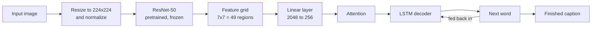
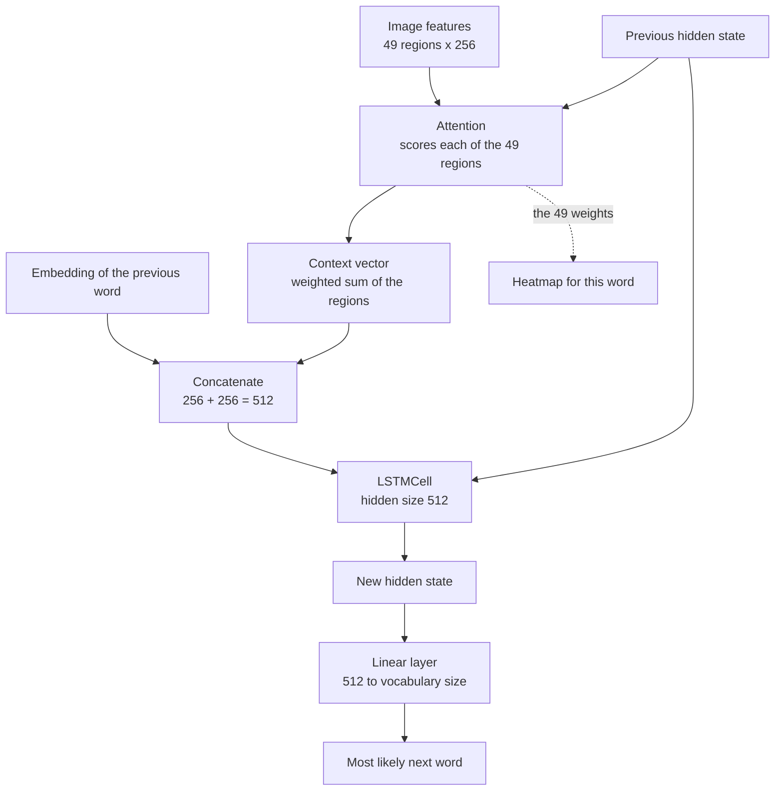
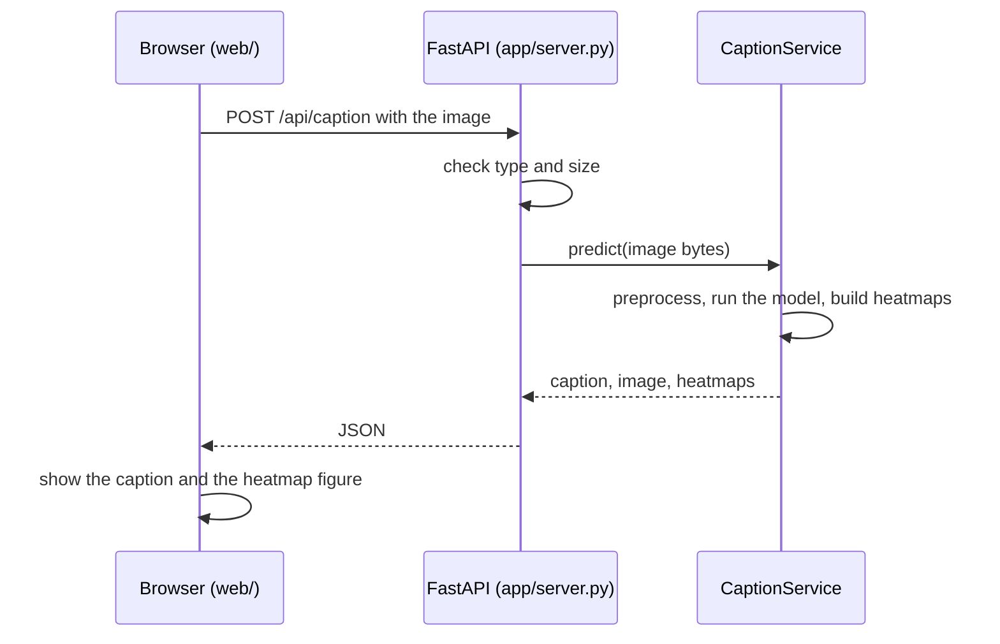

# Visual-Semantic-Encoder: Image Captioning with Attention

Upload a photo and the model writes a sentence describing it. It can also show **where it was looking** for every word it wrote, as a set of attention heatmaps.

The project contains everything from the neural network and its training code to a small web app:

- A PyTorch image-captioning model: **pretrained ResNet-50 encoder + additive attention + LSTM decoder**, trained on MS COCO.
- Training, evaluation (BLEU) and command-line inference scripts.
- A **FastAPI** server and a plain **HTML / CSS / JavaScript** web page: upload an image, read the caption, and open all the heatmaps in one figure.

> **Note:** this is an educational project. Captions are generated by a small model trained on one dataset and can be wrong, especially for unusual images. See [Limitations and ideas](#limitations-and-ideas).

---

## Table of contents

1. [Overview](#overview)
2. [Screenshots](#screenshots)
3. [How it works](#how-it-works)
4. [The model in detail](#the-model-in-detail)
5. [Project structure](#project-structure)
6. [Quick start](#quick-start)
7. [Using the web app](#using-the-web-app)
8. [Command-line tools](#command-line-tools)
9. [Training your own model](#training-your-own-model)
10. [Checkpoint and vocabulary files](#checkpoint-and-vocabulary-files)
11. [API reference](#api-reference)
12. [Evaluation](#evaluation)
13. [Deployment](#deployment)
14. [Limitations and ideas](#limitations-and-ideas)
15. [Troubleshooting](#troubleshooting)
16. [Glossary](#glossary)
17. [References and credits](#references-and-credits)

---

## Overview

**Image captioning** means teaching a computer to look at a picture and describe it in a sentence, for example *"a man riding a horse on a beach"*.

This project does it in three ideas:

1. **See:** a convolutional network (ResNet-50) turns the photo into a grid of 49 feature vectors, one for each region of the image.
2. **Focus:** an *attention* mechanism looks at that grid before each word and decides which regions matter right now.
3. **Write:** an *LSTM* language model produces the caption one word at a time, using the focused image information plus the words it has already written.

Because the attention step produces a weight for each of the 49 regions, we can draw those weights on top of the photo. That is the **heatmap**: bright areas are where the model was looking when it chose that word.

| Part | What it is |
|---|---|
| Model | ResNet-50 (frozen, ImageNet-pretrained) + additive attention + LSTM decoder, about 256 / 512 / 256 dimensions |
| Data | MS COCO 2017 captions (about 118k training images, 5 captions each) |
| Training code | `train.py` (command line), resumable, saves a checkpoint after every epoch |
| Interfaces | Web app, REST API, command-line scripts |
| Language / frameworks | Python 3.11, PyTorch 2.1, FastAPI, vanilla JavaScript |

---

## Screenshots

<!--
Add your own screenshots here, for example:


-->

Run the web app (see [Quick start](#quick-start)) to try it yourself.

---

## How it works

### The big picture



### One decoding step, in detail

The decoder writes the caption one word at a time. At every step it does the following:



The dotted arrow is the interesting part: the attention weights are both *used* by the model and *shown* to you as a heatmap.

### Step by step for one image

1. The image is resized to 224x224 and normalized with the ImageNet mean and standard deviation.
2. ResNet-50 turns it into a `2048 x 7 x 7` feature map. That is 49 regions, each described by 2048 numbers.
3. A linear layer reduces each region to 256 numbers, giving a `49 x 256` grid.
4. The decoder starts with the special `<SOS>` (start) token and zero hidden state.
5. At each step the attention layer scores the 49 regions, builds a context vector, and the LSTM predicts the next word. The word with the highest probability is chosen (*greedy decoding*).
6. This repeats until the model outputs `<EOS>` (end) or reaches 20 words.
7. Each word's 49 attention weights are reshaped to a `7 x 7` map, scaled to 0..1, enlarged to the size of the photo, coloured with the "jet" colormap and blended 50/50 with the photo. These are the heatmaps.

### How the model learns (training)

The model is shown an image and a human caption, for example *"A man riding a horse."* The caption is turned into numbers and wrapped in start and end tokens:

| Position | 1 | 2 | 3 | 4 | 5 | 6 |
|---|---|---|---|---|---|---|
| **Input** to the decoder | `<SOS>` | a | man | riding | a | horse |
| **Target** (what it should predict) | a | man | riding | a | horse | `<EOS>` |

At every position the model must predict the next word, and it is told the *correct* previous word even if it would have guessed wrong. This is called **teacher forcing**. The error is measured with cross-entropy loss, ignoring padding, and the optimizer (Adam) nudges the weights to reduce it.

---

## The model in detail

All sizes below are the defaults used by `train.py`.

### Components

| Component | File | What it does | Shapes |
|---|---|---|---|
| **Encoder** | `models/encoder.py` | Frozen ImageNet-pretrained ResNet-50 without its pooling and classification layers, followed by dropout (0.3) and a trainable `Linear(2048, 256)` | `(B,3,224,224)` to `(B,2048,7,7)` to `(B,49,2048)` to `(B,49,256)` |
| **Attention** | `models/attention.py` | Additive (Bahdanau-style) attention | features `(B,49,256)` + hidden `(B,512)` to weights `(B,49,1)` and context `(B,256)` |
| **Decoder** | `models/decoder.py` | Word embedding, `LSTMCell`, dropout (0.3) and an output layer over the vocabulary | input `(B,T)` to scores `(B,T-1,V)` |
| **Combined model** | `models/combined_model.py` | Connects the encoder and decoder | |

`B` is the batch size, `T` the caption length, and `V` the vocabulary size (roughly ten thousand words; count the lines of `checkpoints/vocab.txt` for your exact number).

### The attention formula

For every image region `i` and the decoder's current hidden state `h`:

```
score_i = full_att( tanh( encoder_att(feature_i) + decoder_att(h) ) )
alpha   = softmax over the 49 regions of score_i
context = sum_i  alpha_i * feature_i
```

`alpha` sums to 1 over the 49 regions. A large `alpha_i` means region `i` matters for the next word. Those 49 numbers, reshaped to `7 x 7`, are what the heatmaps show.

### Why the ResNet is frozen

The first version of this project trained a small five-layer CNN from scratch on 60,000 captions. That is not enough data to learn good visual features, so captions were often wrong even on training images. Using a ResNet-50 already trained on ImageNet gives the decoder good features from the start, and it only has to learn how to turn them into language. The backbone's weights and BatchNorm statistics are kept fixed; only the projection layer, attention and decoder are trained. Fine-tuning the backbone is a possible improvement (see [Limitations and ideas](#limitations-and-ideas)).

### Vocabulary and tokenization

Implemented in `utils/vocab.py`.

- Text is lower-cased and split into words with the pattern `\b\w+\b`, so punctuation is dropped.
- Four special tokens always exist: `<PAD>` = 0, `<SOS>` = 1, `<EOS>` = 2, `<UNK>` = 3.
- Every word that appears **at least 5 times** across *all* training captions gets its own number. Rarer words become `<UNK>`.
- The vocabulary is saved as `vocab.txt` (one `index:word` line per entry) and also inside the checkpoint. A trained model only works with the vocabulary it was trained with.

### Image preprocessing

Implemented in `utils/dataset.py` (`build_transform`), used for training and inference alike: resize to 224x224 (the aspect ratio is not preserved), convert to a tensor, and normalize with mean `[0.485, 0.456, 0.406]` and standard deviation `[0.229, 0.224, 0.225]`.

### Heatmap generation

Implemented in `app/inference_service.py`. For each generated word the 49 attention weights are reshaped to `7x7`, scaled so the smallest value is 0 and the largest is 1 **for that word**, enlarged to the photo's size with bilinear interpolation, coloured with matplotlib's `jet` colormap (blue = low, red = high) and averaged with the photo. Because every word is scaled on its own, the colours show *relative* focus within that word, not an absolute confidence.

---

## Project structure

```text
Visual-Semantic-Encoder/
├── app/
│   ├── inference_service.py   # CaptionService: loads the model once, returns caption + heatmaps
│   └── server.py              # FastAPI app: /api/caption, /api/health, serves web/
├── web/                       # The frontend (no build step)
│   ├── index.html
│   ├── style.css
│   ├── app.js
│   ├── config.js              # API_BASE and repository link
│   └── examples/              # example1.jpg, example2.jpg, example3.jpg (clickable samples)
├── models/
│   ├── encoder.py             # ResNet-50 encoder
│   ├── attention.py           # additive attention
│   ├── decoder.py             # LSTM decoder with attention
│   └── combined_model.py      # encoder + decoder
├── utils/
│   ├── vocab.py               # Vocabulary: build, save, load
│   ├── dataset.py             # COCO loading, preprocessing, Dataset, collate function
│   ├── checkpoint.py          # save / load checkpoints, rebuild a model for inference
│   ├── visualization.py       # greedy caption generation + attention plot
│   └── evaluation.py          # BLEU-1 / BLEU-4
├── inference/
│   ├── caption_pred.py        # caption one image from the command line
│   └── metric_eval.py         # BLEU on COCO val2017
├── data/
│   └── MSCOCO.txt             # notes on the expected dataset layout
├── images/                    # images used by earlier versions of this README
├── train.py                   # training entry point
├── repack_pth.py              # helper: rebuild a .pth file that was unpacked into a folder
├── requirements.txt           # model + training dependencies
├── requirements-app.txt       # + web app dependencies (FastAPI, uvicorn)
└── checkpoints/               # YOU create this: checkpoint_img_caption.pth + vocab.txt (not in git)
```

Checkpoints, datasets and virtual environments are ignored by git (see `.gitignore`).

---

## Quick start

This runs the web app on your own computer. You need a trained checkpoint; the repository does not include one because it is about 220 MB. Either [train your own](#training-your-own-model) or get the file `checkpoint_img_caption.pth` from someone who has trained it.

### Requirements

- **Python 3.11.** The pinned PyTorch version (2.1.0) does not install on Python 3.12 or newer.
- Git.
- No GPU is needed to *use* the model. A GPU is strongly recommended for *training*.

### 1. Get the code and create an environment

Windows (PowerShell):

```powershell
git clone https://github.com/dhruvlad1/Visual-Semantic-Encoder.git
cd Visual-Semantic-Encoder
py -3.11 -m venv .venv
.\.venv\Scripts\Activate.ps1
python -m pip install --upgrade pip
python -m pip install -r requirements-app.txt
```

macOS / Linux:

```bash
git clone https://github.com/dhruvlad1/Visual-Semantic-Encoder.git
cd Visual-Semantic-Encoder
python3.11 -m venv .venv
source .venv/bin/activate
python -m pip install --upgrade pip
python -m pip install -r requirements-app.txt
```

> Create the virtual environment **inside this folder**. A `.venv` copied from another project contains hard-coded paths and will fail with "Fatal error in launcher".

### 2. Add the trained model

Create a `checkpoints` folder in the project root and put the checkpoint in it:

```text
checkpoints/
└── checkpoint_img_caption.pth     (about 220 MB, one single file)
```

`vocab.txt` is optional, because the vocabulary is stored inside the checkpoint. If you received one, put it in the same folder.

### 3. Start the server

Always start it **from the project root**, because the default model path is relative:

```bash
python -m uvicorn app.server:app --port 8000
```

Wait for `Application startup complete`, then open **http://127.0.0.1:8000/** in your browser.

Interactive API documentation is available at **http://127.0.0.1:8000/docs**.

---

## Using the web app

1. **Choose an image:** click the upload box, drag a file onto it, paste an image with Ctrl+V, or click one of the example thumbnails. PNG, JPEG and WEBP files up to 5 MB are accepted. Transparent PNGs are placed on a white background.
2. The upload box disappears and the page shows your image on the left and the caption on the right.
3. Click **Show heatmap** to open one figure that contains the heatmap of **every word** of the caption, side by side, each labelled with its word.
4. Click **Download heatmap** to save that whole figure as a single `heatmaps.png`.
5. Click **Choose another image** to start over.

Privacy: the server processes each image in memory and does not store it. (The web framework may briefly buffer larger uploads in a temporary file while the request is running.)

The server handles one image at a time. A request that takes longer than 60 seconds is cancelled by the page with a friendly error.

---

## Command-line tools

Run all of these from the project root. Use `python -m` for the scripts inside `inference/` so that the `models` and `utils` packages are found.

### Caption one image

```bash
python -m inference.caption_pred --image path/to/photo.jpg --checkpoint checkpoints/checkpoint_img_caption.pth
```

It prints the caption and opens a window with one attention overlay per word.

| Option | Meaning |
|---|---|
| `--vocab FILE` | Only needed for checkpoints that do not contain a vocabulary |
| `--no-plot` | Print the caption only, do not open the window |
| `--save out.png` | Also save the attention figure to a file |
| `--device cpu` / `cuda` | Choose the device (automatic by default) |

### Caption one image and save every heatmap as a PNG

```bash
python -m app.inference_service --image path/to/photo.jpg --checkpoint checkpoints/checkpoint_img_caption.pth --out heatmaps_out
```

### Measure quality with BLEU

```bash
python -m inference.metric_eval --dataset-dir path/to/coco2017 --checkpoint checkpoints/checkpoint_img_caption.pth --num-images 500
```

This needs `val2017/` and `annotations/captions_val2017.json` (see [Training your own model](#training-your-own-model) for the layout).

---

## Training your own model

### 1. Get the dataset

Download **MS COCO 2017** from [cocodataset.org](https://cocodataset.org/#download): the *2017 Train images*, *2017 Val images* and *2017 Train/Val annotations*. Arrange them like this:

```text
coco2017/
├── train2017/                       # about 118,000 training images
├── val2017/                         # about 5,000 validation images (for BLEU)
└── annotations/
    ├── captions_train2017.json
    └── captions_val2017.json
```

Each image has about five human-written captions.

### 2. Train

```bash
python train.py --dataset-dir path/to/coco2017 --epochs 10 --batch-size 64 --subset-size 100000
```

| Option | Default | Meaning |
|---|---|---|
| `--dataset-dir` | `data/coco2017` | COCO root folder |
| `--epochs` | `10` | Passes over the selected captions |
| `--batch-size` | `64` | Samples per training step |
| `--subset-size` | `100000` | Number of training captions to use. `0` = use all (about 590,000) |
| `--lr` | `4e-4` | Adam learning rate |
| `--freq-threshold` | `5` | Minimum word count to enter the vocabulary |
| `--num-workers` | `0` on Windows, `2` elsewhere | Data-loading worker processes |
| `--checkpoint-dir` | `checkpoints` | Where the outputs are written |
| `--resume FILE` | none | Continue from a saved checkpoint |

What happens:

1. All training captions are read and the vocabulary is built and saved to `checkpoints/vocab.txt`.
2. The first captions (up to `--subset-size`) are used for training.
3. The pretrained ResNet-50 weights are downloaded the first time (about 100 MB, **Internet needed once**).
4. After **every epoch** the checkpoint is saved to `checkpoints/checkpoint_img_caption.pth`, so you can stop and resume with `--resume`.
5. At the end the loss curve is saved to `checkpoints/loss_curve.png`.

Tips:

- **Use a GPU.** A free [Kaggle](https://www.kaggle.com) notebook GPU works well: add a COCO 2017 dataset, switch on the GPU and Internet, and point `--dataset-dir` at the dataset folder.
- Do a **quick test first** with `--epochs 1 --subset-size 2000` to check that everything runs and to measure the time per epoch.
- More captions and more epochs generally improve results, but with diminishing returns while the encoder is frozen.
- The checkpoint is large because it also contains the frozen ResNet weights and the optimizer state.

---

## Checkpoint and vocabulary files

A checkpoint (`.pth`) is a PyTorch file that stores:

| Key | Content |
|---|---|
| `epoch` | Index of the last finished epoch |
| `model_state_dict` | All model weights |
| `optimizer_state_dict` | Optimizer state, needed only to resume training |
| `loss` | Average training loss of that epoch |
| `vocab_itos` | The vocabulary (index to word), so the file is self-contained |

`vocab.txt` holds the same vocabulary as text, one `index:word` pair per line:

```text
0:<PAD>
1:<SOS>
2:<EOS>
3:<UNK>
4:a
5:man
...
```

For inference, `utils.checkpoint.load_for_inference(...)` rebuilds the model from the file. It reads the layer sizes from the saved weights themselves, so you do not have to pass the model dimensions.

Good to know:

- A `.pth` file is secretly a **zip archive**. If a download or unzip tool *extracts* it, you end up with a folder named `checkpoint_img_caption.pth` that contains `data.pkl`, `data/` and so on, and loading fails with `Permission denied`. Download the file again, or rebuild it with `python repack_pth.py <unpacked_folder> <new_file.pth>`.
- The vocabulary and the checkpoint **must come from the same training run**.
- Checkpoints from the older small-CNN version of this project do not fit the current model.

---

## API reference

The server (`app/server.py`) exposes two endpoints and also serves the web page from the `web/` folder.

### `GET /api/health`

Returns `{"status": "ok"}` once the server is running. The web page calls it on load to wake up a sleeping host.

### `POST /api/caption`

Upload an image as multipart form data in a field named `file`.

```bash
curl -F "file=@photo.jpg" http://127.0.0.1:8000/api/caption
```

Successful response (`200`):

```json
{
  "caption": "a man riding a horse on a beach",
  "words": ["a", "man", "riding", "a", "horse", "on", "a", "beach"],
  "image": "data:image/png;base64,...",
  "heatmaps": ["data:image/png;base64,...", "..."]
}
```

- `image` is the uploaded picture, resized so its longest side is at most 640 px.
- `heatmaps[i]` is the overlay for `words[i]`.
- Images are returned as base64 PNG data URIs, so no extra files are needed.

Errors:

| Status | Meaning |
|---|---|
| `400` | The file could not be read as an image |
| `413` | The file is larger than the upload limit |
| `415` | Only PNG, JPEG and WEBP are accepted |
| `422` | The `file` field is missing |
| `500` | Unexpected server error (details are logged on the server) |

Errors have the form `{"error": "message"}`; the `422` response uses FastAPI's standard `{"detail": [...]}` form.

### Configuration (environment variables)

| Variable | Default | Meaning |
|---|---|---|
| `CHECKPOINT_PATH` | `checkpoints/checkpoint_img_caption.pth` | Model file to load at startup |
| `VOCAB_PATH` | unset | Only needed if the checkpoint has no built-in vocabulary |
| `DEVICE` | `cpu` | `cpu` or `cuda` |
| `ALLOWED_ORIGINS` | `*` | Comma-separated list of websites allowed to call the API (CORS) |
| `MAX_UPLOAD_MB` | `5` | Maximum upload size |

Example (PowerShell): `$env:DEVICE="cuda"; python -m uvicorn app.server:app --port 8000`



The model is loaded **once** when the server starts, and requests are handled one after another.

---

## Evaluation

Caption quality is measured with **BLEU**, which counts how many words (BLEU-1) or four-word sequences (BLEU-4) of the generated caption also appear in the human reference captions. Scores range from 0 to 1; higher is better. They are only a rough guide: a perfectly good caption can score low if it uses different words than the references.

`inference/metric_eval.py` scores the model on COCO **val2017** images that it never saw during training. Each image is compared with all of its human captions, and BLEU-4 uses smoothing so that short captions do not collapse to zero.

<!--
Record your own results here after running metric_eval, for example:

| Model | Training captions | Epochs | BLEU-1 | BLEU-4 |
|---|---|---|---|---|
| ResNet-50 + attention + LSTM | 100,000 | 10 | 0.xx | 0.xx |
-->

---

## Deployment

The web app has two parts that can be hosted separately:

- **Backend** (`app/server.py`) needs Python and PyTorch, so it must run on a host that supports them (for example a Hugging Face Space or Render). The checkpoint is too large for GitHub (100 MB limit), so it has to be uploaded to the host separately and found through `CHECKPOINT_PATH`.
- **Frontend** (`web/`) is plain static files and can go on any static host (for example Vercel or GitHub Pages).

When the two are on different websites:

1. In `web/config.js`, set `API_BASE` to the backend's URL, for example `https://your-space.hf.space` (no trailing slash).
2. On the backend, set `ALLOWED_ORIGINS` to the frontend's address instead of `*`.
3. Free hosts often put the backend to sleep. The page sends a warm-up request on load and shows a "server is waking up" message if the first caption takes more than a few seconds.

---

## Limitations and ideas

**Current limitations**

- The model learned from COCO, so it knows everyday scenes (people, animals, vehicles, food, indoor and street scenes) and can fail on anything else (medical images, diagrams, art, unusual objects).
- Captions can be wrong, generic, or repeat words. They can also reflect biases present in the training data.
- Decoding is **greedy**: the single most likely word is chosen at every step, with no beam search.
- The ResNet-50 encoder is frozen, and only a subset of the captions is used by default.
- English only.
- The server processes one image at a time.
- The images are squeezed to a square 224x224 for the model, which distorts the aspect ratio.

**Ideas for improvement**

- Train on all captions and for more epochs.
- Fine-tune the last ResNet block.
- Add **beam search** when generating captions.
- Replace the LSTM with a Transformer decoder, or use a stronger pretrained encoder.
- Evaluate with additional metrics (METEOR, CIDEr).
- Add authentication, rate limiting and request logging before exposing the API publicly.

---

## Troubleshooting

| Problem | Cause and fix |
|---|---|
| `Fatal error in launcher: Unable to create process using ...pip.exe` | The virtual environment was copied from another folder. Delete `.venv`, create a new one in this folder (`py -3.11 -m venv .venv`) and use `python -m pip ...`. |
| `pip install` fails for `torch==2.1.0` or `numpy==1.25.0` | You are on Python 3.12 or newer. Use **Python 3.11**. |
| `ModuleNotFoundError: No module named 'models'` | Run scripts from the project root and use `python -m inference.caption_pred ...` instead of `python inference/caption_pred.py`. |
| `FileNotFoundError: Image not found` | The `--image` path is wrong. Use a real file and quote paths that contain spaces. |
| Server fails to start with a checkpoint error | The default path is `checkpoints/checkpoint_img_caption.pth`, relative to where you start the server. Start it from the project root or set `CHECKPOINT_PATH`. |
| `PermissionError: [Errno 13] ... checkpoint_img_caption.pth` | The checkpoint is a **folder** (it was unzipped). Download it again without extracting, or use `repack_pth.py`. |
| `The vocabulary has N words but the model expects M` | The vocabulary does not belong to this checkpoint. Use the `vocab.txt` from the same training run. |
| `size mismatch` when loading weights | The checkpoint was made with a different model version (for example the old small CNN). Use a checkpoint trained with this code. |
| Training or the first run cannot download ResNet weights | The first training run needs an Internet connection to fetch the pretrained ResNet-50. Loading a finished checkpoint does not. |
| The browser shows an old version of the page | Hard refresh with **Ctrl+Shift+R**. |
| `Address already in use` | Another program uses port 8000. Start with `--port 8001`. |
| Captions look random | The model is under-trained or the checkpoint is from a very short test run. Train longer or use a better checkpoint. |
| The example thumbnails are broken | `web/examples/example1.jpg`, `example2.jpg` and `example3.jpg` are missing. Add three small images with exactly those names. |

---

## Glossary

| Term | Meaning |
|---|---|
| **Encoder** | The part that turns the image into numbers the decoder can use (here, ResNet-50). |
| **Decoder** | The part that turns those numbers into words, one at a time (here, an LSTM). |
| **CNN** | Convolutional neural network, a standard model type for images. |
| **ResNet-50** | A well-known 50-layer CNN. Here it comes pretrained on ImageNet. |
| **Attention** | A mechanism that lets the decoder weight image regions differently for every word. |
| **LSTM** | Long short-term memory, a recurrent network that reads and writes sequences while keeping a memory. |
| **Hidden state** | The LSTM's memory of everything written so far. |
| **Embedding** | A learned list of numbers that represents a word. |
| **Token** | One unit of text: a word or a special marker such as `<SOS>`. |
| **Vocabulary** | The list of all words the model knows, each with a number. |
| **Teacher forcing** | Training trick: the model is always shown the correct previous word. |
| **Cross-entropy loss** | The error measure for choosing the right next word. |
| **Epoch** | One pass over the selected training captions. |
| **Greedy decoding** | Always picking the single most likely next word. |
| **Beam search** | Keeping several candidate sentences at once and choosing the best (not implemented here). |
| **Checkpoint** | A saved copy of the model's weights (and training state). |
| **BLEU** | A score that compares a generated caption with human reference captions. |
| **Heatmap** | The attention weights drawn over the photo: red means "looked here a lot". |
| **Frozen** | Weights that are not updated during training. |

---

## References and credits

- Xu et al., *Show, Attend and Tell: Neural Image Caption Generation with Visual Attention*, ICML 2015. The attention-based captioning idea implemented here.
- Bahdanau, Cho and Bengio, *Neural Machine Translation by Jointly Learning to Align and Translate*, ICLR 2015. The additive attention formulation.
- He et al., *Deep Residual Learning for Image Recognition*, CVPR 2016. ResNet.
- Lin et al., *Microsoft COCO: Common Objects in Context*, ECCV 2014. The dataset ([cocodataset.org](https://cocodataset.org)). COCO annotations are released under CC BY 4.0; the images come from Flickr and have their own terms.
- Papineni et al., *BLEU: a Method for Automatic Evaluation of Machine Translation*, ACL 2002.
- Built with [PyTorch](https://pytorch.org), [torchvision](https://pytorch.org/vision), [FastAPI](https://fastapi.tiangolo.com) and [NLTK](https://www.nltk.org).

