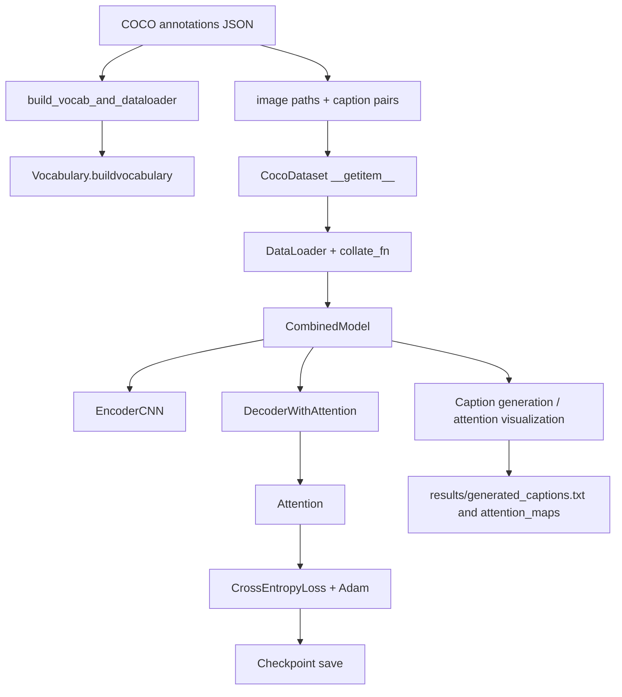

# Project Technical Knowledge Base

## 1. Project Overview

- What the project does
  - This repository builds and trains a custom image captioning model in PyTorch.
  - The model takes an image as input, encodes it with a CNN, attends to relevant spatial regions, and decodes a natural-language caption with an LSTM-based decoder.
  - The project is implemented as a compact research/training pipeline rather than a deployed application.

- Problem it solves
  - It provides a minimal working pipeline for translating image content into short textual descriptions using a CNN encoder + attention + decoder architecture.
  - The project is focused on learning and demonstrating image-caption generation behavior, not on production-scale captioning services.

- Target users/use case
  - The intended users are researchers, students, or engineers learning image captioning architectures.
  - The project assumes local execution on a machine with a COCO-style dataset and Python dependencies installed.
  - Use cases are training a captioning model and generating captions/attention visualizations for individual images.

- Main features
  - Custom CNN encoder in models/encoder.py
  - Additive attention mechanism in models/attention.py
  - LSTMCell-based decoder in models/decoder.py
  - Combined model wrapper in models/combined_model.py
  - Vocabulary construction from captions in utils/vocab.py
  - PyTorch dataset loader for image-caption pairs in utils/dataset.py
  - Training loop in train.py
  - Caption generation with attention in utils/visualization.py
  - BLEU-based evaluation in utils/evaluation.py and inference/metric_eval.py
  - Checkpoint save/load logic in utils/checkpoint.py and train.py
  - Attention-map visualization output

- Current implementation status
  - Functional training and inference pipeline exists.
  - The project is script-driven and local-only.
  - No production web app, no database layer, and no formal test suite were found in the codebase.

- What makes the project technically interesting
  - It is a compact, end-to-end image captioning system implemented from scratch in PyTorch.
  - The architecture explicitly combines spatial feature extraction with attention-guided sequential generation.
  - The model is designed to expose attention maps, making the decoder behavior inspectable rather than opaque.
  - The repository path is educational: the important logic is clear and directly traceable to the source files.

## 2. One-Minute Interview Explanation

This project is a small PyTorch image captioning system that learns to describe images using a CNN encoder, additive attention, and an LSTM decoder. It reads COCO-style image-caption pairs, builds a vocabulary from the captions, trains the model with teacher forcing, and then generates captions for new images while highlighting which image regions the model attended to. The main technologies are Python, PyTorch, torchvision, PIL, NumPy, Matplotlib, and NLTK. The real technical contribution is not a large framework or service—it is a compact, readable implementation of the classic encoder-decoder attention model for visual caption generation.

## 3. Complete Tech Stack

| Technology               |                                                                        Version | Where Used                                                          | Why Used                                                              | Role                  |
| ------------------------ | -----------------------------------------------------------------------------: | ------------------------------------------------------------------- | --------------------------------------------------------------------- | --------------------- |
| Python                   | Not pinned in repo; README says Python 3.11 is used in the working environment | Project runtime                                                     | Primary language for model code and training scripts                  | Programming language  |
| PyTorch                  |                                                                          2.1.0 | train.py, models/_, utils/_                                         | Deep learning framework for model definition, training, and inference | Core ML framework     |
| torchvision              |                                                                         0.16.0 | train.py, inference/caption_pred.py, inference/metric_eval.py       | Image preprocessing and transforms                                    | Vision utilities      |
| Pillow                   |                                                                         10.1.0 | utils/dataset.py, utils/visualization.py, inference/caption_pred.py | Image loading and conversion                                          | Image I/O             |
| NumPy                    |                                                                         1.25.0 | utils/visualization.py                                              | Array operations for plotting attention maps                          | Numerical library     |
| Matplotlib               |                                                                          3.8.0 | train.py, utils/visualization.py                                    | Loss plotting and attention visualization                             | Visualization         |
| NLTK                     |                                                                          3.8.1 | inference/metric_eval.py                                            | BLEU evaluation                                                       | Evaluation library    |
| tqdm                     |                                                                         4.66.1 | train.py                                                            | Training progress bar                                                 | UX/logging            |
| CUDA / GPU               |                                                  Optional, automatic detection | train.py, inference/caption_pred.py                                 | Hardware acceleration when available                                  | Execution environment |
| COCO dataset             |                  Not versioned in repo; dataset path defaults to data/coco2017 | train.py, inference/metric_eval.py                                  | Training and evaluation data                                          | Data source           |
| Local filesystem         |                                                                 Not a database | data/, images/, results/, checkpoints                               | Storage for training data, outputs, and checkpoints                   | Storage               |
| JSON                     |                                                               Standard library | train.py, inference/metric_eval.py                                  | Reading COCO annotations                                              | Data format           |
| argparse                 |                                                               Standard library | train.py, inference/caption_pred.py, inference/metric_eval.py       | CLI configuration                                                     | Interface             |
| File-based checkpointing |                                                  PyTorch torch.save/torch.load | train.py, utils/checkpoint.py                                       | Persist model and optimizer state                                     | Model persistence     |
| Frontend framework       |                                                          Not found in codebase | Not implemented                                                     | Not applicable                                                        | Frontend              |
| Backend framework        |                                                          Not found in codebase | Not implemented                                                     | Not applicable                                                        | Backend               |
| Database                 |                                                          Not found in codebase | Not implemented                                                     | No persistence layer beyond local files and checkpoints               | Database              |
| Authentication           |                                                          Not found in codebase | Not implemented                                                     | No user accounts or secure sessions                                   | Security              |
| Caching                  |                                                          Not found in codebase | Not implemented                                                     | No Redis or in-memory cache                                           | Performance           |
| Queues                   |                                                          Not found in codebase | Not implemented                                                     | No asynchronous workers                                               | Background processing |
| API                      |                                                          Not found in codebase | Not implemented                                                     | No HTTP API surface                                                   | Integration           |
| Docker                   |                                                          Not found in codebase | Not implemented                                                     | No containerization files were found                                  | Deployment            |
| CI/CD                    |                                                          Not found in codebase | Not implemented                                                     | No GitHub Actions or similar config was found                         | Automation            |
| Testing framework        |                                                          Not found in codebase | No tests directory or test files were found                         | No automated test harness exists                                      | Validation            |

## 4. Architecture

Architecture style: This project is a script-based, research-oriented PyTorch pipeline. There is no multi-service web architecture, no REST API, and no persistent application state. The architecture is a direct end-to-end training pipeline with a local filesystem data source and local outputs.

Frontend/backend relationship: Not applicable in the usual web sense. The repository exposes command-line entry points instead of a frontend application. The “frontend” is effectively the user’s shell or Python script execution environment.

Request/response flow: There is no request/response HTTP flow. Model training and inference are invoked from Python scripts. The equivalent flow is CLI arguments -> dataset loading -> model forward pass -> output caption/attention visualization.

Major modules:

- train.py: training orchestration and checkpoint saving
- models/encoder.py: CNN visual feature encoder
- models/attention.py: attention scoring and context vector generation
- models/decoder.py: sequential word generation
- models/combined_model.py: model composition
- utils/vocab.py: tokenization and vocabulary building
- utils/dataset.py: image-caption dataset + padding
- utils/visualization.py: caption generation with attention and plotting
- inference/caption_pred.py: script for generating a caption for a single image
- inference/metric_eval.py: script for BLEU evaluation
- utils/checkpoint.py: checkpoint loading

Database: Not found in codebase. The project reads COCO JSON and local image files, and writes checkpoints and result files to disk.

External APIs/services: None implemented. There are no remote API calls or cloud services in the repository.

Authentication flow: Not implemented. No login, tokens, sessions, or authorization checks exist.

Data flow: COCO captions JSON -> image filenames -> caption list -> vocabulary -> dataset -> batched tensors -> model -> loss -> checkpoint -> generated caption.

Deployment architecture: Not implemented. The repo does not include Docker, deployment manifests, hosting config, or CI deployment automation.

Mermaid diagram:



## 5. Project Directory Structure

```text
Image_Caption_Generator/
├── README.md
├── requirements.txt
├── train.py
├── data/
│   └── MSCOCO.txt
├── images/
├── inference/
│   ├── caption_pred.py
│   ├── metric_eval.py
│   └── visualize_attention.py
├── models/
│   ├── attention.py
│   ├── combined_model.py
│   ├── decoder.py
│   └── encoder.py
├── results/
│   ├── generated_captions.txt
│   └── attention_maps/
├── utils/
│   ├── checkpoint.py
│   ├── dataset.py
│   ├── evaluation.py
│   ├── visualization.py
│   └── vocab.py
└── .gitignore
```

Important files and responsibilities:

- README.md
  - Project documentation and architecture overview.
  - The source-of-truth for the intended model description and high-level project goals.

- requirements.txt
  - Declares the exact Python dependencies used by the project.
  - Confirms the ML stack: PyTorch, TorchVision, NumPy, Matplotlib, Pillow, tqdm, NLTK.

- train.py
  - Main training entry point.
  - Builds vocabulary, creates dataloader, initializes model/optimizer, and runs training.
  - Saves checkpoints and plots training loss.

- models/encoder.py
  - Implements the CNN encoder that produces spatial feature embeddings.
  - Converts image feature maps to a sequence of visual tokens per pixel location.

- models/attention.py
  - Implements soft additive attention.
  - Combines encoder image context and decoder hidden state to form attention weights.

- models/decoder.py
  - Implements the LSTMCell-based decoder that autoregressively generates words.
  - Uses teacher forcing during training by consuming shifted captions.

- models/combined_model.py
  - Composes encoder and decoder into a single model interface.
  - Provides the forward pass used by training and inference.

- utils/vocab.py
  - Builds token-to-index mappings and numericalizes text into integer IDs.
  - Adds special tokens: <PAD>, <SOS>, <EOS>, <UNK>.

- utils/dataset.py
  - Defines CocoDataset and the batch collation logic.
  - Loads each image and wraps the caption with start and end tokens.
  - Pads captions for batched training.

- utils/visualization.py
  - Implements caption generation and visual attention plotting.
  - Produces image–heatmap overlays for each predicted word.

- inference/caption_pred.py
  - Generates a caption for a single supplied image from a saved checkpoint.
  - Loads checkpoint and vocabulary state and calls the generation path.

- inference/metric_eval.py
  - Evaluates the trained model using BLEU score over a subset of the dataset.

- utils/checkpoint.py
  - Loads saved PyTorch model state and optimizer state from disk.

- results/
  - Stores generated captions and attention-map outputs.
  - Serves as the repository’s artifact directory for inference outputs.

- data/
  - Contains COCO metadata or supporting files.
  - In this repo, the actual training script expects a COCO directory structure under data/coco2017, not a specific file parser for the MSCOCO.txt file.

## 6. End-to-End Execution Flow

### Main training flow

1. User action
   - Run train.py from the project root.
   - The user passes optional flags such as dataset directory, epochs, batch size, subset size, learning rate, and checkpoint directory.

2. Frontend processing
   - There is no frontend. The CLI arguments are parsed with argparse.
   - The process starts in train.py: main().

3. API request
   - Not applicable. There is no HTTP API layer.

4. Backend processing
   - build_vocab_and_dataloader() reads the COCO annotation JSON file at the configured dataset directory.
   - It creates a mapping from image IDs to image filenames and builds a list of (image_path, caption) pairs.
   - Vocabulary.buildvocabulary() tokenizes all captions and builds a frequency-based vocabulary.
   - CocoDataset wraps each image and caption.
   - DataLoader batches data using collate_fn.

5. Business logic
   - The core business logic is the training objective: model predicts next caption tokens conditioned on image features and previous tokens.
   - The decoder sees the shifted caption and tries to predict the next word at each time step.
   - Loss is computed with nn.CrossEntropyLoss(ignore_index=vocab.stoi["<PAD>"]).
   - The optimizer is Adam.

6. Database/external service interaction
   - Reads local image files and COCO annotation JSON.
   - Writes checkpoint files to disk.
   - No database or external API is used.

7. Response generation
   - The training loop produces loss values per epoch and saves a checkpoint.
   - At the end of training, a loss curve is plotted with Matplotlib.

8. Frontend handling
   - No frontend exists. Output is console logs and generated plots/images.

9. UI/result
   - Training results appear as terminal stats and loss curve plots.
   - Inference output is produced later through caption_pred.py and attention visualizations.

### Inference flow

1. User action
   - Invoke python inference/caption_pred.py --image ... --checkpoint ...

2. Script behavior
   - load_vocab() optionally reads a vocabulary file.
   - CombinedModel is instantiated with the vocabulary size.
   - load_checkpoint() restores the trained weight state.

3. Model execution
   - Image is preprocessed using Resize -> ToTensor -> Normalize.
   - generate_caption_with_attention() runs the model in evaluation mode.
   - The encoder produces a visual feature sequence.
   - The decoder auto-regressively selects the next word until <EOS> or max length.
   - Attention weights are saved for each decoded word.

4. Result
   - The script prints the predicted caption and visualizes heatmaps for each word using utils/visualization.py.

## 7. Frontend Deep Dive

Framework and architecture: Not implemented. There is no frontend framework, package.json, browser UI, or app shell in the repository.

Routing: Not found in codebase.

Components: Not found in codebase.

State management: Not found in codebase.

API communication: No client-side HTTP calls exist.

Hooks: Not found in codebase.

Forms: Not found in codebase.

Error handling: Not applicable for a frontend layer because there is no frontend layer.

Loading states: Not applicable.

Important UI logic: The only “UI” is console output and image plots generated by Matplotlib.

Reusable components: Not implemented.

Data flow: The user interacts with scripts via CLI, not with a GUI or browser.

Performance considerations: Since no UI layer exists, there are no frontend bundle or rendering constraints to optimize.

Why this design: The project is research-oriented. The architecture prioritizes algorithm clarity and model experimentation over user interface polish.

## 8. Backend Deep Dive

Server/framework: Not implemented. This is not a web backend. The code is a Python ML pipeline executed directly from scripts.

Entry point: train.py is the core training entry point. Inference entry points include inference/caption_pred.py and inference/metric_eval.py.

Routes/endpoints: Not found in codebase. No HTTP routes or REST API definitions are present.

Controllers/handlers: Not found in codebase.

Services: The closest equivalent to backend services are the utility and model modules:

- Vocabulary creation
- Dataset loading and batching
- Model training
- Checkpoint management
- Caption generation
- BLEU evaluation

Business logic: The model learns to predict caption tokens conditioned on image embeddings and previous words. The key logic is in CombinedModel.forward(), DecoderWithAttention.forward(), and Attention.forward().

Validation: No formal validation framework. The scripts validate only by checking file existence and dataset structure; there is no schema validation layer.

Middleware: Not found in codebase.

Error handling: Basic file existence checks exist. For example:

- build_vocab_and_dataloader() raises FileNotFoundError if COCO captions file is missing.
- It raises ValueError if no image-caption pairs are loaded.
- caption_pred.py checks whether the image file and checkpoint exist.

Authentication/authorization: Not implemented.

Database interaction: None.

External API calls: None.

Background processing: Not implemented.

Important endpoints: Not applicable.

## 9. Database Deep Dive

Database technology: Not found in codebase. The project does not use a database engine, ORM, or data store beyond local disk files.

Schema: Not applicable.

Tables/collections: None.

Important fields: None.

Relationships: None.

Indexes: None.

Queries: None.

CRUD operations: Not implemented.

Migrations: Not found in codebase.

Why this database was used: No database was needed because the repository is an educational image captioning model.

How data flows through the application: Local image files + COCO JSON annotations are read directly from disk and transformed into tensors; no database layer sits between them.

## 10. Core Algorithms and Logic

### 1) CNN visual encoder

Problem: Convert an image into a compact set of spatially aware feature vectors that the language model can condition on.

Approach: A 5-stage CNN that downsamples the image and projects the flattened feature map into an embedding space.

Implementation: EncoderCNN in models/encoder.py

- Sequential conv blocks: 3 -> 32 -> 64 -> 128 -> 256 -> 512
- Each block uses Conv2d, BatchNorm2d, ReLU
- Dropout(0.3) before projection
- Feature map is reshaped from (B, 512, H', W') into (B, num_pixels, 512)
- Linear(512, embed_size) projects to the decoder embedding space

Why this approach: It provides a fixed-length, spatially structured representation of the image without using a pretrained backbone.

Complexity: O(B _ H _ W \* C) per image, with fixed CNN layers.

Edge cases: The model expects RGB images and uses Resize((224, 224)) before tensor conversion.

### 2) Additive attention

Problem: The decoder should focus on the most relevant image regions at each word generation step.

Approach: Soft attention that uses the previous decoder hidden state and image encoder outputs to compute attention weights.

Implementation: Attention in models/attention.py

- encoder_att: nn.Linear(encoder_dim, attention_dim)
- decoder_att: nn.Linear(decoder_dim, attention_dim)
- tanh(encoder_att + decoder_att)
- full_att produces scalar attention score per pixel
- softmax over spatial positions
- context = sum(encoder_out \* alpha)

Why this approach: It is a clear, interpretable attention mechanism that is easy to implement and visualize.

Complexity: O(B _ num_pixels _ attention_dim)

Edge cases: The attention map is used only for gradient-based visual inspection; there is no explicit alignment regularization beyond the learned softmax weights.

### 3) LSTMCell decoder with teacher forcing

Problem: Generate a caption token-by-token and keep sequence generation conditioned on the image.

Approach: Use an LSTMCell to model temporal dependencies while receiving image context at each step.

Implementation: DecoderWithAttention in models/decoder.py

- embedding layer maps token IDs to vectors
- lstm input is concatenation of current token embedding and attention context
- hidden state h and cell state c are carried across time steps
- final linear layer maps hidden state to vocabulary logits

Training logic: captions[:, :-1] is fed to the decoder and caption[:, 1:] is the target, aligning on shifted sequence positions.

Why this approach: Teacher forcing stabilizes training and makes the decoder learn to predict the next token based on the previous ground-truth token sequence instead of only its own predictions.

Edge cases: The model is trained with a padding ignore index; the dataset includes <PAD> tokens in the batch collation.

### 4) Vocabulary construction and tokenization

Problem: Convert text captions into numeric IDs that the model can process.

Approach: frequency-based vocabulary with special tokens.

Implementation: Vocabulary in utils/vocab.py

- regex-based tokenizer: re.findall(r"\b\w+\b", text)
- lowercases text
- special tokens: <PAD>, <SOS>, <EOS>, <UNK>
- word included if frequency >= freq_threshold

Why this approach: It keeps the model compact and avoids a massive vocabulary when rare words are present.

Edge cases: Words outside the vocabulary map to <UNK>.

### 5) BLEU evaluation

Problem: Quantify caption quality against reference captions.

Approach: Use corpus BLEU from NLTK.

Implementation: evaluate_bleu() in utils/evaluation.py and metric_eval.py

- generate candidate captions for each image
- compare to ground-truth captions
- compute BLEU-1 and BLEU-4 using NLTK translate.bleu_score.corpus_bleu

Why this approach: It is a standard machine translation/image captioning metric and is simple to integrate.

## 11. AI/ML/LLM Details

This project is not an LLM or transformer-based system. It is a classical CNN-attention-LSTM architecture.

- Model(s): custom EncoderCNN + DecoderWithAttention
- Model purpose: image-to-text caption generation
- Prompting: Not implemented; there is no prompt-based language model interface
- Preprocessing: Resize to 224x224, convert to tensor, normalize using ImageNet mean/std values
- Postprocessing: Token-to-word decoding through vocab.itos; stop at <EOS>
- Embeddings: learned token embeddings in nn.Embedding(vocab_size, embed_size)
- Vector databases: Not found in codebase
- RAG: Not implemented
- Agents: Not implemented
- Tools/chains: Not implemented
- Memory: LSTMCell hidden and cell states provide the decoder memory
- Model fallback: Not implemented
- Structured outputs: Not implemented
- Evaluation: BLEU-1 and BLEU-4 via NLTK
- Hallucination prevention: Not implemented as a strategy; model is deterministic and greedy by argmax during generation
- Token/cost considerations: Not relevant because this is a local model implementation, not a hosted LLM API
- Latency considerations: The repository is not optimized for production throughput; inference is done sequentially word-by-word

## 12. API and Integration Details

External integrations: None. The project does not call third-party APIs or remote services.

Internal API surface: The code exposes Python functions and CLI scripts rather than HTTP endpoints.

Key data integrations:

- COCO annotation JSON read from disk
- image files loaded from the dataset directory
- checkpoint files loaded from disk
- outputs saved to local result directories

Authentication method: Not applicable.

Failure handling: Basic file existence checks and exception raises; no retry/backoff logic or remote fallback behavior.

Rate limits: Not applicable.

Retry/fallback behavior: Not implemented.

## 13. Important Technical Decisions

Decision: Use a custom CNN + attention + LSTM implementation instead of a pretrained backbone.
Why it was needed: The repository is intentionally compact and self-contained.
Why this approach was chosen: The README and code emphasize a research-oriented, simple architecture. There is no evidence of a larger model ecosystem or transfer-learning pipeline.
How it is implemented: EncoderCNN in models/encoder.py and DecoderWithAttention in models/decoder.py.
Alternative approaches: Pretrained encoders (ResNet, CNN backbones), transformers, or pretrained image captioning models.
Trade-offs: Lower baseline quality than modern pretrained systems, but clearer code and easier educational understanding.

Decision: Use teacher forcing during training.
Why it was needed: The sequence model needs a stable training signal.
Why this approach was chosen: It is standard and easy to implement in the current decoder loop.
How it is implemented: The model is trained on captions[:, :-1] with targets captions[:, 1:].
Alternative approaches: Scheduled sampling or fully autoregressive training from model predictions.
Trade-offs: Faster and more stable learning, but some mismatch with inference-time generation behavior.

Decision: Use local COCO dataset files and a CLI-driven workflow.
Why it was needed: The project is a repository rather than an app.
Why this approach was chosen: Minimal dependencies and direct experimentation are prioritized.
How it is implemented: JSON parsing and file I/O in train.py and metric_eval.py.
Alternative approaches: Database-backed pipelines or API-driven training services.
Trade-offs: Fast to run locally, but limited operational tooling and no orchestration layer.

Decision: Save checkpoints to disk.
Why it was needed: Training and inference are separated.
Why this approach was chosen: The code explicitly wants to store model state and optimizer state.
How it is implemented: torch.save() in train.py and torch.load() in utils/checkpoint.py.
Alternative approaches: Model registry services or cloud ML artifact storage.
Trade-offs: Simple and reliable, but not production-grade artifact management.

## 14. Security

Implemented security mechanisms:

- No authentication system exists.
- No authorization enforcement exists.
- No CORS layer because no web server exists.
- No secrets management is required because no cloud or credentials are used.
- Input validation is minimal and local-only. The scripts check whether files exist before processing.
- Injection prevention: no SQL, query layer, or remote command execution path is present.
- Data protection: no user data, signed tokens, or external storage service is used.
- Frontend security: not applicable.
- Dependency/security considerations: The project relies on Python packages listed in requirements.txt, but no security scanning or dependency lockfile workflow is included.

Not found in codebase: authentication, authorization, secure secret storage, API security controls, rate limiting, TLS configuration, SSRF protections, etc.

## 15. Performance and Scalability

Actual measured performance numbers: None are present in the repository. No benchmark logs, performance tables, or timings are included.

Actual configuration limits:

- Default epochs: 60
- Default batch size: 32
- Default subset size: 60000
- CPU/GPU detection is automatic via torch.cuda.is_available()
- DataLoader subset size is configurable via subset-size parameter

Scalability considerations:

- The project is single-machine and local-process.
- It uses a fixed CNN + LSTM design and sequential decoding.
- Training and inference are not distributed or parallelized across workers.
- There is no model-serving engine or background queue.

Bottlenecks:

- Sequential word generation is slower than parallel decoding methods.
- Full training on COCO can be heavy without GPU acceleration.
- The architecture is not optimized for low-latency production inference.

Current limitations:

- No distributed training or large-scale deployment.
- No validation subset or early stopping logic beyond raw training.
- No benchmarks or throughput reporting.

## 16. Important Metrics and Numbers

| Metric                                 |                        Value | Where it comes from                    | Notes                                   |
| -------------------------------------- | ---------------------------: | -------------------------------------- | --------------------------------------- |
| Epochs default                         |                           60 | train.py argparse                      | Training parameter                      |
| Batch size default                     |                           32 | train.py argparse                      | Training parameter                      |
| Subset size default                    |                        60000 | train.py argparse                      | Used for data subset                    |
| Learning rate default                  |                         1e-3 | train.py argparse                      | Optimizer config                        |
| Vocabulary frequency threshold default |                            5 | train.py argparse                      | Vocabulary filtering                    |
| Encoder embedding size                 |                          256 | train.py and models/combined_model.py  | Model dimension                         |
| Hidden size                            |                          512 | train.py and models/decoder.py         | Decoder memory size                     |
| Image resize                           |                      224x224 | train.py and inference/caption_pred.py | Input preprocessing                     |
| Attention dimension                    |                          256 | models/decoder.py                      | attention_dim                           |
| Vocabulary special tokens              |                            4 | utils/vocab.py                         | <PAD>, <SOS>, <EOS>, <UNK>              |
| Loss function                          |             CrossEntropyLoss | train.py                               | With ignore_index on <PAD>              |
| Optimizer                              |                         Adam | train.py                               | Default optimizer                       |
| BLEU metrics                           |            BLEU-1 and BLEU-4 | utils/evaluation.py                    | Evaluation outputs                      |
| Dataset format                         | COCO captions_train2017.json | train.py                               | Annotation source                       |
| Number of model files                  |              4 under models/ | Repository structure                   | Core model components                   |
| Number of utility modules              |               5 under utils/ | Repository structure                   | Supporting functions                    |
| Number of inference scripts            |                            3 | repository structure                   | Prediction + evaluation + visualization |
| No frontend app                        |                    Not found | codebase inspection                    | Confirms script-only architecture       |
| No database                            |                    Not found | codebase inspection                    | Confirms filesystem-only data flow      |
| No tests                               |                    Not found | repository structure                   | No test suite present                   |

## 17. Deployment and DevOps

Local setup:

- Clone repository.
- Create a Python environment.
- Install dependencies from requirements.txt.
- Prepare a COCO-style dataset directory containing train2017/ and annotations/.
- Run train.py or inference/caption_pred.py.

Environment variables:

- Not found in codebase.
- No .env management or configuration file was discovered.

Build process:

- No formal build system exists.
- The implementation is executed directly by Python scripts.

Docker:

- Not found in codebase.
- No Dockerfile or docker-compose file was identified.

Hosting:

- Not implemented.
- The repo does not define a production host or deployment target.

CI/CD:

- Not found in codebase.
- No GitHub Actions or other pipeline configurations were discovered.

Production configuration:

- None.

Health checks:

- Not implemented.

Monitoring/logging:

- Basic print statements and tqdm progress bars are used.
- No structured logging or operational telemetry exists.

Deployment flow:

- None; this is not a deployed service.

## 18. Error Handling and Edge Cases

Important failure scenarios and how the code handles them:

- Missing COCO dataset files
  - train.py raises FileNotFoundError when captions_train2017.json is absent.
  - inference/metric_eval.py does the same.

- Empty dataset after filtering
  - build_vocab_and_dataloader() raises ValueError when no image-caption pairs are found.

- Missing image file or checkpoint
  - caption_pred.py checks existence and raises FileNotFoundError.

- Vocabulary mismatch between checkpoint and vocabulary
  - caption_pred.py explicitly warns in the CLI help that a missing vocab file may produce a mismatch with the checkpoint.

- Batch shape mismatch during training
  - The code slices outputs and targets to the minimum length: min_len = min(outputs.size(1), targets.size(1)).

- Padding token handling
  - nn.CrossEntropyLoss(ignore_index=vocab.stoi["<PAD>"]) ensures padded positions do not contribute to the loss.

- Sequence termination
  - generate_caption and generate_caption_with_attention stop when the model predicts <EOS> or reaches max_len.

- Unknown words
  - Vocabulary.numericalize() maps unknown tokens to <UNK>.

- Empty attention list
  - There is no explicit guard; the code assumes a valid caption with at least one non-<EOS> token.

- GPU availability
  - device = torch.device("cuda" if torch.cuda.is_available() else "cpu") handles CPU/GPU fallback.

## 19. Testing

Testing framework: Not found in codebase.

Test structure: No tests/ directory or test files were found.

Unit tests: None.

Integration tests: None.

API tests: None.

Frontend tests: None.

Coverage: Not available.

What is not currently tested:

- model training stability over multiple seeds
- dataset edge cases
- mismatch between vocab and checkpoint
- caption quality under varied inputs
- checkpoint loading robustness
- error paths for missing files or invalid image content

This is a codebase that demonstrates the model, but it does not yet provide a formal automated validation harness.

## 20. What Happens Internally

The most important feature is the image-caption generation loop.

Detailed trace:

- User runs the CLI script.
- In train.py, main() parses configuration arguments.
- build_vocab_and_dataloader() reads the COCO JSON and creates a list of training pairs.
- Vocabulary.buildvocabulary() converts every caption to lowercase tokens and filters by frequency.
- CocoDataset.**getitem** loads the image with Pillow and wraps the caption with <SOS> and <EOS> tokens.
- collate_fn pads captions with <PAD> and stacks images into a PyTorch batch.
- CombinedModel.forward() calls encoder(images) and decoder(encoder_out, captions).
- EncoderCNN.forward() runs the CNN stack, flattens the spatial map, and projects it to embed_size.
- DecoderWithAttention.forward() iterates through the caption positions. At each step:
  - It retrieves the current word embedding.
  - It calls self.attention(encoder_out, h), where attention combines encoded image features with the current hidden state.
  - It concatenates the embedding and context vector into the LSTM input.
  - It updates the hidden state and outputs logits for the next vocabulary item.
- The training loop reshapes outputs and targets to 2D and computes CrossEntropyLoss.
- Backpropagation updates model weights via Adam.
- save_checkpoint() writes model_state_dict, optimizer_state_dict, epoch, and loss to disk.

At inference time:

- caption_pred.py loads the checkpoint and vocabulary.
- generate_caption_with_attention() uses the encoder to compute encoder_out, initializes the decoder hidden state, and greedily selects the argmax token at each step until <EOS> or max length.
- attention maps are stored for each generated word and visualized using Matplotlib.

This is the actual internal flow from CLI -> dataset -> model -> loss -> checkpoint -> caption generation -> attention output.

## 21. Limitations and Known Issues

Current limitations:

- No web app or production deployment layer exists.
- No database and no persistent service architecture exist.
- The project is CPU-first and GPU-optional, but there is no orchestration for distributed training.
- Vocabulary is simplistic and frequency-based rather than a learned or subword-based tokenizer.
- Caption generation is greedy (argmax) rather than beam search or constrained decoding.
- There is no validation split or early stopping strategy beyond raw training loops.
- No safety, moderation, or prompt injection layer exists because the system is not LLM-based.

Technical debt:

- Training and inference logic are split across different modules but still rely on manual coordination and file-based artifact handling.
- No package-level abstraction or configuration layer exists.
- No standardized model registry or experiment tracking.

Missing tests:

- No unit or integration tests.
- No evaluation harness beyond optional BLEU scripts.

Scalability limitations:

- Sequential decoder generation limits throughput and latency.
- Not built for large-scale distributed training or serving.

Security limitations:

- No auth or secret handling.
- No formal input sanitization beyond file checks.

Incomplete features:

- No API/server layer
- No model registry or versioned deployment workflow
- No user interface or dashboard

## 22. Possible Improvements

These are FUTURE improvements and not currently implemented:

- Scalability
  - Add a validation split and early-stopping logic.
  - Use larger and more modern CNN backbones or pretrained vision encoders.
  - Experiment with transformer-based decoders for better sequence modeling.

- Performance
  - Add beam search for caption generation.
  - Use GPU-optimized batch training and mixed precision where available.
  - Add model profiling and benchmark logging.

- Security
  - Add a web layer only if an application is required; then introduce authentication and secure config management.
  - Enforce strict file validation and restrict local dataset paths.

- Architecture
  - Package the model into a reusable training/inference library.
  - Separate configuration from logic and add experiment metadata.

- Testing
  - Add automated tests for dataset loading, vocab behavior, loss computation, and checkpoint compatibility.
  - Add integration tests for caption generation on a fixed image.

- UX
  - Expose a CLI or web UI for selecting images and viewing generated captions.
  - Add better visualization and comparison tooling for captions and attention maps.

- Reliability
  - Add retry logic for dataset loading and checkpoint verification.
  - Add logging for failed training runs and corrupted checkpoints.

- Maintainability
  - Introduce configuration files and clearer project packaging.
  - Add experiment tracking and checkpoint versioning.

## 23. Interview Questions and Answers

### Basic

Q: What does the project do?
A: It trains and runs a custom image captioning model that turns an image into a natural-language caption using CNN feature extraction, attention, and an LSTM decoder.
Evidence/implementation: README.md, train.py, models/encoder.py, models/decoder.py.
Relevant file/function: train.py: main(), CombinedModel.forward().

Q: Why did you build it?
A: Based on the repo, it appears to be a compact educational/research implementation focused on learning and visualizing image caption generation rather than building a production service.
Evidence/implementation: README.md explicitly describes the project as compact and research-oriented.
Relevant file/function: README.md, train.py.

Q: What is your role?
A: In this repo, the role is effectively the builder of the end-to-end training pipeline: data loading, vocabulary construction, training, inference, and evaluation.
Evidence/implementation: The responsibilities are distributed across train.py, utils/_, and inference/_.
Relevant file/function: train.py: build_vocab_and_dataloader(), train_model(); inference/caption_pred.py: main().

Q: What technologies did you use?
A: Python, PyTorch, torchvision, Pillow, NumPy, Matplotlib, NLTK, and COCO dataset files.
Evidence/implementation: requirements.txt and source imports.
Relevant file/function: requirements.txt; train.py imports and model files.

### Architecture

Q: Explain the architecture.
A: The project uses a CNN encoder to convert an image into spatial features, an additive attention module to weight the relevant regions, and an LSTM decoder to generate caption tokens sequentially.
Evidence/implementation: EncoderCNN, Attention, DecoderWithAttention, CombinedModel.
Relevant file/function: models/encoder.py, models/attention.py, models/decoder.py, models/combined_model.py.

Q: Why did you separate frontend and backend?
A: There is no frontend/backend separation because the project is not a web app. The “backend” here is the Python training pipeline executed from scripts.
Evidence/implementation: No web framework or app routes were found.
Relevant file/function: train.py, inference/\*.py.

Q: How does data flow through the system?
A: COCO JSON -> image/caption pairs -> vocabulary -> dataset batches -> model -> loss -> checkpoints -> generated caption/attention output.
Evidence/implementation: train.py, utils/dataset.py, utils/vocab.py, utils/visualization.py.
Relevant file/function: build_vocab_and_dataloader(), CocoDataset.**getitem**(), collate_fn().

Q: Why did you choose this architecture?
A: Because the codebase is explicitly a compact image captioning implementation designed for clarity and visibility of attention behavior, not a production API service.
Evidence/implementation: README description and model design.
Relevant file/function: README.md, models/attention.py.

### Code-Level

Q: Which file/function handles X?
A: For dataset preparation, train.py build_vocab_and_dataloader() is the entry. For model training, train_model() in the same file handles optimization and checkpointing. For generation, generate_caption_with_attention() in utils/visualization.py handles caption decoding and attention visualization.
Evidence/implementation: Source file definitions.
Relevant file/function: train.py: build_vocab_and_dataloader(), train_model(); utils/visualization.py: generate_caption_with_attention().

Q: How does X communicate with Y?
A: The data pipeline passes tensors between dataset, model, and loss functions directly in Python memory. There is no service bus or network API. The model receives images and captions as tensors and returns logits.
Evidence/implementation: CombinedModel.forward() and training loop in train.py.
Relevant file/function: train.py: outputs = model(images, captions[:, :-1]); models/combined_model.py: forward().

Q: How is state/data managed?
A: Data flows through local Python structures and PyTorch tensors. Model state is stored in torch modules and checkpoint files.
Evidence/implementation: load_checkpoint() and save_checkpoint() in train.py and utils/checkpoint.py.
Relevant file/function: save_checkpoint(), load_checkpoint().

Q: How are errors handled?
A: The code checks for missing files and empty datasets and raises clear exceptions such as FileNotFoundError and ValueError.
Evidence/implementation: train.py and caption_pred.py.
Relevant file/function: build_vocab_and_dataloader(), main() in caption_pred.py.

### Technology Decisions

Q: Why did you use PyTorch?
A: Because the code implements a neural network and training loop directly in PyTorch, and requirements.txt pins PyTorch and torchvision.
Evidence/implementation: requirements.txt and all model files use torch.nn and optimizer APIs.
Relevant file/function: train.py import torch, models/\*.py.

Q: Why this database?
A: No database is used. The project uses local COCO dataset files on disk instead of a database.
Evidence/implementation: No database usage or schema is present.
Relevant file/function: train.py and data/ directory.

Q: Why this API/service?
A: No external or internal API/service is used. The implementation is a local CLI-driven ML workflow.
Evidence/implementation: No route definitions or API framework imports were found.
Relevant file/function: None.

### Performance

Q: What are the bottlenecks?
A: The decoder generates captions sequentially; each word is produced one step at a time, which is slower than parallel decoding. Training also depends on full COCO training data and can be heavy without CUDA.
Evidence/implementation: DecoderWithAttention.forward() loops over timesteps and uses hidden-state updates per token.
Relevant file/function: models/decoder.py: for t in range(embeddings.size(1)):

Q: How would you scale it?
A: The codebase does not currently implement distributed scaling. A future version would likely add a more modern backbone, stronger hardware support, and a more scalable training pipeline.
Evidence/implementation: no distributed or async infrastructure is present.
Relevant file/function: train.py.

Q: How would you reduce latency?
A: Replace greedy generation with beam search, reduce vocabulary size, or use a faster pretrained encoder; this is future work, not current code.
Evidence/implementation: current generation uses argmax and a single-step loop.
Relevant file/function: utils/visualization.py: predicted = output.argmax(1).

### Security

Q: How are secrets handled?
A: There are no secrets to manage in this repo. No API keys, tokens, or cloud credentials are used.
Evidence/implementation: No authentication or secret references in code.
Relevant file/function: project source files.

Q: How is authentication implemented?
A: Not implemented. This repo is not a user-facing service and does not expose protected endpoints.
Evidence/implementation: no auth code or route layer exists.
Relevant file/function: none.

### Failure Scenarios

Q: What happens if the dataset is missing?
A: The script raises FileNotFoundError and stops.
Evidence/implementation: train.py and inference/metric_eval.py check the annotation file path.
Relevant file/function: build_vocab_and_dataloader(), main() in metric_eval.py.

Q: What happens if a checkpoint is missing or mismatched?
A: The inference script raises FileNotFoundError or may produce incorrect output if the vocabulary mismatches the checkpoint.
Evidence/implementation: caption_pred.py checks checkpoint existence and warns that a vocab mismatch can occur.
Relevant file/function: caption_pred.py: load_vocab(), main().

Q: What happens if the model times out or generation gets stuck?
A: Generation is bounded by max_len and terminates on <EOS>.
Evidence/implementation: loop in utils/visualization.py loops for max_len and breaks when predicted_word == "<EOS>".
Relevant file/function: generate_caption_with_attention().

### Deep Technical

Q: Why is the decoder trained with captions[:, :-1] and targets captions[:, 1:]?
A: This is the standard teacher-forcing pattern: the model learns to predict each next token from the preceding caption token sequence, while the special wrapping tokens define the start and end of the caption.
Evidence/implementation: The training loop explicitly does outputs = model(images, captions[:, :-1]) and targets = captions[:, 1:].
Relevant file/function: train.py: train_model().

Q: Why do the attention weights produce a spatial heatmap?
A: Because the attention module computes softmax over all spatial positions and then returns a weighted context vector using alpha. The visualization script reshapes those weights back into a 2D grid.
Evidence/implementation: Attention.forward() and utils/visualization.py: att_map = att_map.reshape(H, W).
Relevant file/function: models/attention.py: forward(); utils/visualization.py: visualize_attention().

Q: Why is the vocabulary frequency filtered?
A: To keep the vocabulary manageable and ignore rare words that may not be statistically significant in the dataset.
Evidence/implementation: vocab.buildvocabulary() includes only words with frequency >= freq_threshold.
Relevant file/function: utils/vocab.py: buildvocabulary().

## 24. "Explain This Project Like I Built It"

I built a compact image captioning system in PyTorch that learns to describe visual content. The goal was not to ship a web app or a production service; it was to build a clear, research-oriented implementation of the classic encoder-decoder image captioning pipeline. The project reads COCO-style images and caption annotations, converts the captions into a vocabulary, and trains a model that takes an image, extracts spatial features with a CNN, attends to the relevant parts of the image, and then generates a caption word by word with an LSTM decoder.

The key implementation decision was to keep the pipeline simple and inspectable. I used a custom CNN in the encoder, a soft additive attention module in the decoder, and a vocabulary-based tokenization layer. That made it easier to explain and visualize how the model decided which regions mattered for words like person, car, or scene. The training loop uses teacher forcing, which is a standard choice for sequence models because it makes learning more stable by aligning the model’s input sequence with the ground-truth next token.

The hardest technical problem was balancing model clarity with sequence generation. The decoder is iterative, so each word is generated one step at a time. The attention module had to aggregate the image feature map and the current hidden state into a single context vector before generating the next output. I solved that by implementing a soft attention layer that produced weights over all spatial positions and then used those weights to construct the context vector. The resulting attention maps are not just diagnostics; they also help validate that the model is attending to meaningful visual regions.

The main trade-off is that this is intentionally a lightweight research implementation rather than a highly optimized modern captioning system. There is no frontend or API wrapper, no database, and no production deployment layer. The project is optimized for transparency and learning rather than scale or service reliability. That said, it still demonstrates the core mechanics of image captioning very clearly: data preparation, tokenization, CNN encoding, attention, sequence generation, checkpointing, and evaluation with BLEU.

If I were to continue, I would add better evaluation, validation logic, and more modern architectural choices, but the current codebase already shows a complete end-to-end project that explains the core concepts in a way that is easy to reason about and discuss in technical interviews.

## 25. Interview Cheat Sheet

- Project elevator pitch:
  - A small PyTorch image captioning model that generates captions from images using a CNN encoder, soft attention, and an LSTM decoder.

- Architecture in 5-10 bullets:
  - COCO-style data is loaded from disk.
  - Captions are tokenized and mapped to integer IDs.
  - Images are resized and normalized.
  - EncoderCNN extracts spatial image features.
  - Attention weights select relevant image regions for each step.
  - DecoderWithAttention generates tokens sequentially.
  - Training uses teacher forcing and CrossEntropyLoss.
  - Outputs include generated captions and attention plots.

- Tech stack:
  - Python, PyTorch, torchvision, Pillow, NumPy, Matplotlib, NLTK, tqdm, COCO dataset

- Important numbers:
  - 60 epochs default
  - 32 batch size default
  - 60000 subset default
  - 256 embedding size
  - 512 hidden size
  - 224x224 image resize

- Key APIs:
  - Not an HTTP API; the key interfaces are Python scripts and model functions

- Key files:
  - train.py
  - models/encoder.py
  - models/attention.py
  - models/decoder.py
  - utils/vocab.py
  - utils/dataset.py
  - utils/visualization.py
  - inference/caption_pred.py
  - inference/metric_eval.py

- Hardest technical components:
  - Attention-driven decoder logic
  - Teacher-forcing sequence training
  - Caption generation with stop condition and attention visualization

- Important design decisions:
  - Custom CNN + attention + LSTM instead of pretrained models
  - Local file-based dataset flow
  - CPU/GPU compatibility
  - Save/load checkpointing

- Biggest challenges:
  - Sequence generation quality and consistency
  - Attention interpretability
  - Performance without distributed training

- Limitations:
  - No frontend or backend service
  - No database
  - No automated tests
  - No modern transformer architecture

- Scalability answer:
  - This project is not built for web-scale serving. It is a research-oriented local training pipeline with limited scaling beyond a single machine.

- Security answer:
  - There is no auth or secure API layer. Security is effectively minimal because the repo is a local training project.

- 10 most likely interviewer questions with short answers:
  1. What does it do? Generates captions from images using a CNN + attention + LSTM pipeline.
  2. Why this architecture? It is clear, compact, and interpretable.
  3. How is data prepared? JSON annotations are converted into image/caption pairs and a vocabulary.
  4. How does attention work? It scores each image spatial location based on encoder and decoder state, then softmaxes the scores.
  5. What is teacher forcing? The decoder sees shifted captions during training to predict the next token.
  6. How is training loss computed? CrossEntropyLoss on the shifted targets, ignoring padding tokens.
  7. How do you generate captions? Greedy decoding from the start token until EOS or max length.
  8. How is the model evaluated? With BLEU-1 and BLEU-4 using NLTK.
  9. What is missing? No API, database, tests, or deployment layer.
  10. What would you improve? Use a stronger backbone, beam search, validation, and more robust experiment tracking.

## Final assessment

This repository is a compact, educational, local-only PyTorch implementation of image caption generation. The technically important parts are the CNN encoder, additive attention, LSTM decoder, teacher forcing, vocabulary handling, and attention visualization. There is no web application layer, no database, no authentication, and no automated testing framework in the current codebase. The project is operational as a research/training pipeline and is best understood as a clear engineering demonstration of classic image captioning mechanics rather than a production system.
